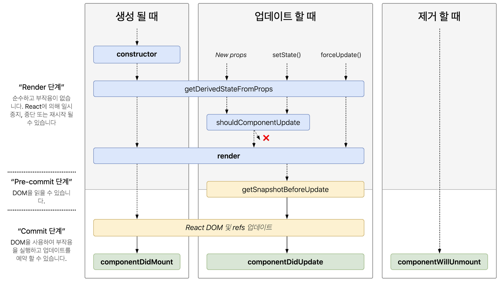
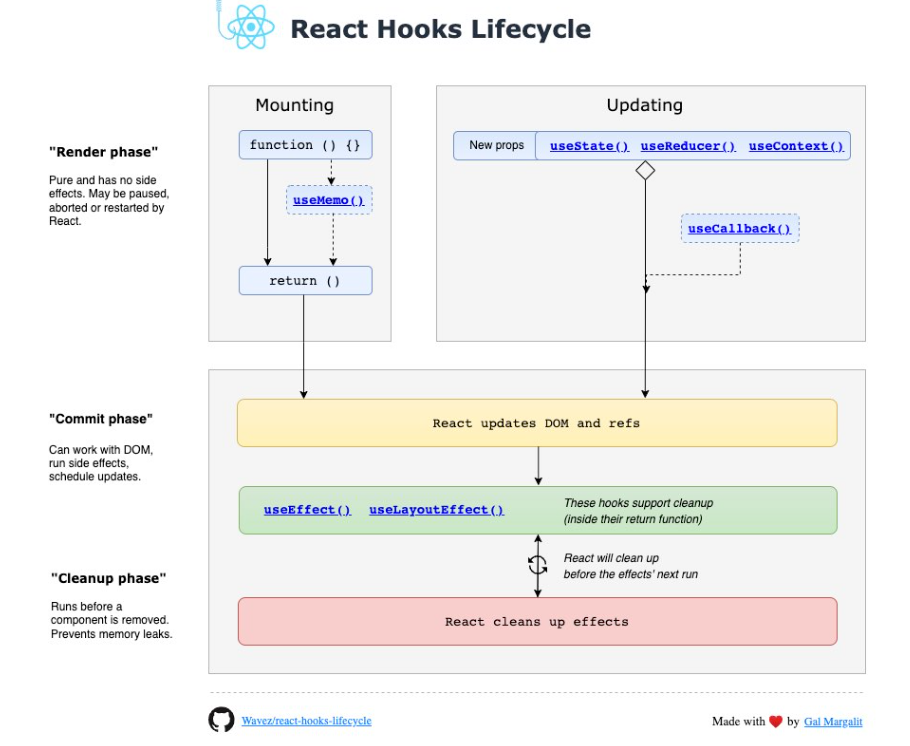
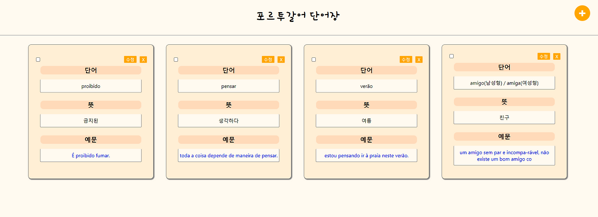
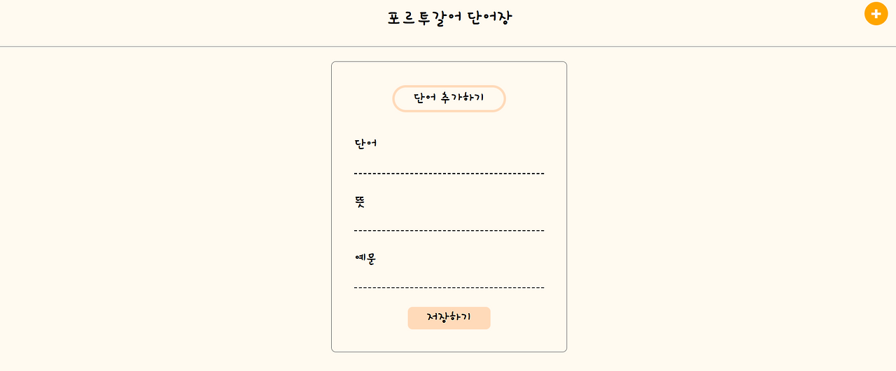

# 리액트 숙련 과정

이번 주차에서는 리액트와 조금 더 친숙해지는 시간을 가진 것 같은데 게시글 입력과 삭제 등의 기능을 파이어스토어와 연결하는 방법을 공부했다. DB와 연결하여 DB에 들어간 내용을 불러오고 삭제하는 기능을 구현하면서 오류가 발생했고 그 오류의 원인에 대해 알게 되며 리덕스로 상태관리하는 부분을 조금 더 공부해야겠다는 생각이 들었다.

## 라이프사이클(class형 컴포넌트 기반)

보통 라이프사이클은 class형 컴포넌트 기반을 이야기하는 것이고 함수형 컴포넌트에서는 Hook을 사용하게 된다. 먼저 class형 컴포넌트 기반의 라이프사이클을 살펴보면 "생성(mounting) -> 업데이트(updating) -> 삭제(unmounting)"와 같은 생명주기를 갖고 있다는 것을 알 수 있다.

### 리액트 사이클 메서드

#### (1) 생성(mounting)

- **constructor**: 컴포넌트가 처음 만들어질 때 실행되는 생성자로 this.props, this.state에 접근할 수 있다.
- **getDerivedStateFromProps()**: props에 있는 값을 state에 동기화 시킬 때 사용하는 메서드이다.
- **render()**: UI를 렌더링하는 메서드이다.
- **componentDidMount()**: 컴포넌트가 첫 렌더링을 마치고 나면 호출되는 메서드이다.

#### (2) 업데이트(updating)

- **getDerivedStateFromProps()**: 마운트 과정에서 호출되며, 업데이트 시작 전 호출된다.
- **render()**: 컴포넌트를 리렌더링하는 메서드이다.
- **shouldComponentUpdate()**: props나 state가 변경되었을 때 리렌더링을 시작할지 여부를 정하는 메서드
- **componentDidUpdate()**: 컴포넌트 업데이트 작업이 끝나고 나면 호출되는 메서드이다.

#### (3) 삭제(unmounting)

- **componentWillUnmount()**: 컴포넌트를 DOM에서 제거할 때 호출되는 메서드이다.

---

## React Hooks(함수형 컴포넌트 기반)

리액트 훅은 리액트 v16.8부터 새로 도입된 기능으로 함수형 컴포넌트에서 사용되는 몇가지 기술을 의미한다. 함수형 컴포넌트에서 상태관리를 할 수 있게 해주는 useState, 렌더링 직후의 작업을 설정하는 useEffect 등의 기능을 제공하는데 기존에는 클래스형 컴포넌트에서만 사용할 수 있던 것들을 함수형 컴포넌트에서도 사용할 수 있도록 해주는 기능인 것이다.

리액트 훅의 주요 특징:
- 함수형 컴포넌트에서 state와 lifecycle 기능 사용 가능
- 코드의 재사용성과 가독성 향상
- 컴포넌트 간 상태 로직 공유 용이

---

## 항해 99 4주차 리액트 개인 과제

**프로젝트 기간:** 2022.03.24~2022.03.28 (총 5일간)

**개인과제명:** 나만의 사전 만들기

### 필수 포함 사항

#### 게시글 목록 페이지
- 게시글 목록을 화면에 그리기 (각각의 뷰는 카드 뷰로)
- 게시글 내의 예시의 경우 파란 글씨로 보여주기
- 게시글 목록을 리덕스를 통해 관리하기
- 게시글 목록을 파이어스토어에서 가져오기

#### 게시글 작성 페이지 기능
- 게시글을 작성할 때 필요한 input 3개를 ref로 관리하기
- 작성한 게시글을 리덕스 내에 있는 게시글 목록에 추가하기
- 게시글 목록을 파이어스토어에 저장하기

#### 추가로 구현한 기능
- 게시글 삭제 기능

### 구현한 페이지 및 기능

#### 1. 게시글 목록 페이지

**게시글 목록 보여주기**
- 게시글 내의 예문 부분을 파란색으로 보여주기
- 게시글 목록은 파이어스토어에 저장되어있는 리스트 목록을 가져오기
- 가져오는 리스트를 리덕스로 관리하기
- \+ 버튼 클릭시 단어 추가하기 페이지로 이동

**게시글 목록 보여주기의 추가기능**
- X 버튼 클릭시 게시물 삭제

#### 2. 게시글 작성 페이지

**게시글 작성하기**
- 저장하기 클릭시 게시물을 파이어스토어에 저장하기
- 저장하기 클릭 후 게시글 목록 페이지로 이동
- 게시글 추가 input을 ref로 관리하기

#### 3. 깃허브 레파지토리

[GitHub - JIEUN24/React_2: React_2](https://github.com/JIEUN24/React_2)

---

## 소감

3주차부터 시작한 리액트를 통해서 4주차에는 나만의 단어장 만들기 과제를 수행했다. 과제를 수행하며 생긴 오류를 다른 구성원들과 공유하며 함께 해결해나가기 위해 노력하였는데 결국 주차 내에 해결하지는 못했다. 

아직 리덕스를 다루는 것에 익숙하지 않아 로드 순서에서 발생한 문제를 해결하지는 못했지만 앞으로 리덕스 역시 꾸준히 공부하면서 어떤 방식으로 게시물을 로드해와야하는지 등에 대해서 되돌아보는 시간을 가져야겠다는 생각이 들었다.

리액트와 파이어스토어를 연동하여 실제 데이터를 다루는 경험을 통해 프론트엔드 개발에 대한 이해가 더욱 깊어졌다. 특히 상태관리의 중요성을 실감하며 리덕스에 대한 학습 필요성을 느꼈다.

4주차 공부시간 기록: 100시간 52분

--- 