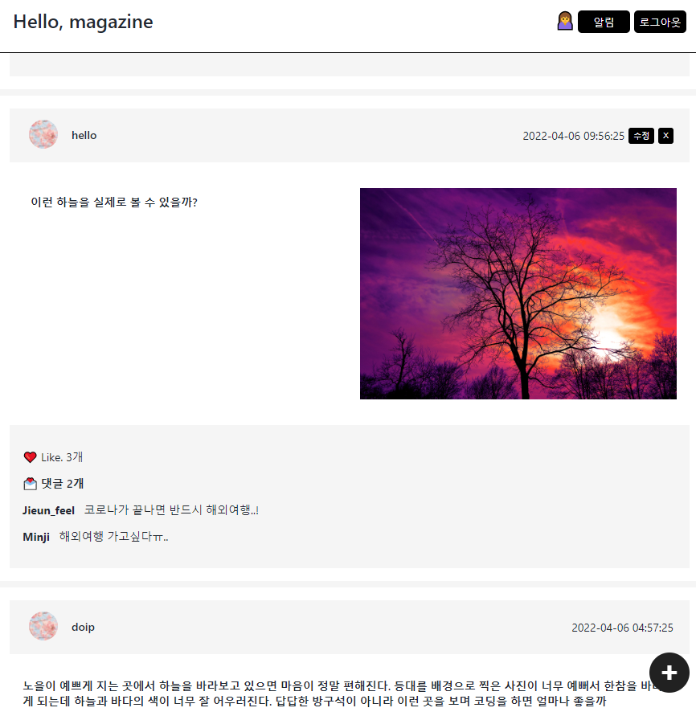
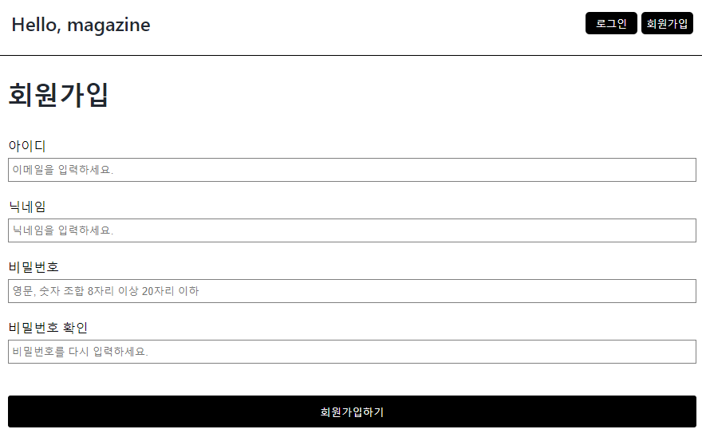
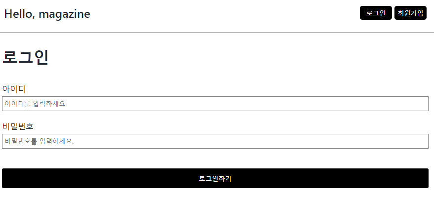
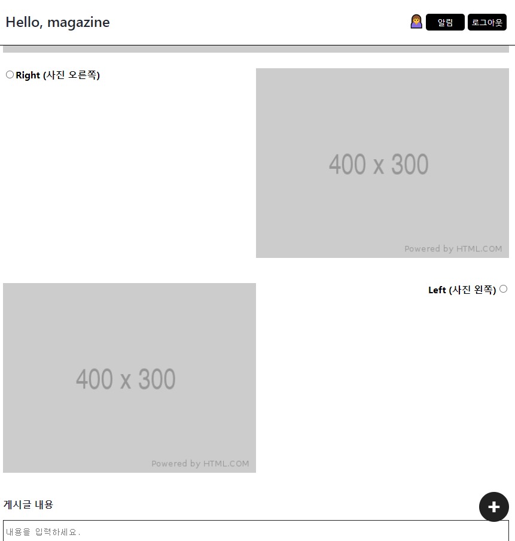

# 리액트 심화 과정

이번 주차에서는 리액트 심화 과정을 통해 **실제 웹 서비스에 필요한 핵심 기능들**을 구현해보았다. Magazine 사이트 만들기 프로젝트를 진행하면서 로그인, 회원가입, CRUD 등 웹 개발의 기본기를 다질 수 있었고, 특히 axios를 활용한 HTTP 비동기 통신에 대해 깊이 학습할 수 있었다.

## Axios - HTTP 비동기 통신 라이브러리

### Axios란?

Axios는 브라우저와 백엔드를 위한, **Promise API를 활용하는 HTTP 비동기 통신 라이브러리**이다. 백엔드와 프론트엔드 통신을 쉽게 하기 위해 Ajax와 비슷하게 활용되며, 현대 웹 개발에서 필수적인 도구 중 하나이다.

### Axios의 주요 특징

- **Promise 기반의 HTTP 클라이언트**: 비동기 처리가 직관적이고 간편함
- **브라우저와 Node.js에서 모두 사용 가능**: 범용성이 뛰어남
- **요청과 응답 인터셉터 제공**: 중간에 데이터를 가공하거나 에러 처리가 가능
- **자동 JSON 데이터 변환**: 별도 파싱 과정 없이 JSON 처리
- **요청 취소 기능**: 필요시 HTTP 요청을 중단할 수 있음
- **광범위한 브라우저 지원**: 구형 브라우저까지 호환

### 실제 사용 경험

이번 프로젝트에서 axios를 사용하면서 기존 fetch API보다 훨씬 편리하다는 것을 체감할 수 있었다. 특히 에러 처리와 요청/응답 데이터 변환이 자동으로 이루어져 개발 효율성이 크게 향상되었다.

---

## 항해99 5주차 리액트 개인 과제

**프로젝트 기간:** 2022.04.01~2022.04.05 (총 5일간)

**개인과제명:** Magazine 사이트 만들기

### 과제 요구사항

#### 핵심 기능 구현

##### 1. 게시글 관리 시스템
- **목록 가져오기**: 상세페이지는 게시글 레이아웃에 맞춰 이미지와 텍스트 위치를 조절해서 노출
- **추가하기(+ 이미지 업로드)**: 
  - 3가지 레이아웃 중 선택하기: 이미지가 오른쪽, 이미지가 왼쪽, 이미지가 아래쪽
  - 레이아웃 선택시, 게시글 레이아웃대로 게시글 보이게 하기
  - 텍스트와 이미지 중 입력이 안된게 있다면 게시글 작성 버튼 비활성화
  - 작성 완료시 메인페이지로 이동
- **삭제하기**: 권한이 있는 사용자만 삭제 가능

##### 2. 사용자 인증 시스템
- **회원가입하기**: 이메일과 비밀번호 형식 체크
- **로그인하기**: 이메일과 패스워드 미기입시 로그인 버튼 비활성화

##### 3. 배포
- **파이어베이스 or S3로 배포**

### 구현한 페이지 및 기능

#### 1. 게시글 페이지(메인)

**게시글 목록 및 레이아웃 시스템**
- 게시글 추가시 선택된 레이아웃 형식으로 글 보여주기 (사진은 오른쪽 이미지 정렬 레이아웃)
- 게시글 클릭시 상세페이지로 이동
- 로그인 시 본인의 게시물이 맞다면 수정과 삭제 버튼 표시

#### 2. 사용자 인증 페이지

**로그인과 회원가입 시스템**
- 아이디와 비밀번호 유효성 검사 구현
- 로그인 성공시 메인페이지로 자동 이동
- 회원가입 완료 후 메인페이지로 리다이렉트

#### 3. 게시글 작성 및 수정 페이지

**게시글 CRUD 시스템**
- 3가지 레이아웃 선택 기능
- 이미지 업로드 및 미리보기 기능
- 게시글 내용 및 이미지 중 하나라도 입력이 안되어있으면 버튼 비활성화
- 게시글 작성 성공시 메인페이지로 이동

#### 4. 추가 구현 기능

**무한스크롤 구현**
- 사용자 경험 향상을 위한 무한스크롤 기능 추가 구현

#### 5. 프로젝트 레포지토리

[GitHub - JIEUN24/React_3_magazine: 항해99 리액트 심화 3주차 magazine 사이트 만들기](https://github.com/JIEUN24/React_3_magazine)

---

## 기술적 성장과 도전

### HTTP 통신의 이해

이번 프로젝트를 통해 **클라이언트-서버 간 데이터 통신의 중요성**을 깨달았다. axios를 사용하여 API 호출 방법을 익히면서 비동기 처리에 대한 이해도가 크게 향상되었다.

### 사용자 인증과 권한 관리

로그인, 회원가입 기능을 구현하면서 **웹 보안의 기초**를 학습할 수 있었다. 특히 사용자 권한에 따른 UI 변화와 데이터 접근 제어의 중요성을 실감했다.

### 이미지 처리와 업로드

이미지 업로드 기능 구현을 통해 **파일 처리와 미리보기 기능**에 대해 학습할 수 있었다. 사용자 경험을 고려한 UI/UX 설계의 중요성도 깨달았다.

---

## 아쉬웠던 점과 개선 방향

### 기술적 한계
- 아직 강의를 보고 따라하는 수준에서 벗어나지 못함
- 일부 기능에서 오류가 발생하여 완전한 구현에 아쉬움
- 코드의 완전한 이해보다는 기능 구현에 치중

### 학습 계획
- 구현한 기능 코드를 다시 분석하여 완전히 내 것으로 만들기
- 오류 해결 과정을 통해 디버깅 능력 향상
- 기본기 다지기를 통한 탄탄한 토대 구축

---

## 소감

5주차를 마무리하며 짧은 시간 내에 여러가지 핵심 기능들을 구현해볼 수 있었다. 아직 기능이 완전하지 않아 오류가 발생하기도 하지만, 그 오류를 해결해나가는 과정에서 조금은 성장한 것 같다는 생각이 든다.

이번 주차를 통해 **HTTP 통신의 중요성**을 깨달았고, axios를 사용한 API 호출 방법을 익힐 수 있었다. 또한 사용자 인증과 권한 관리, 이미지 업로드 등 **실제 웹 서비스에서 필요한 기능들**을 구현해보며 실무에 한 걸음 더 가까워진 것 같다.

다음주는 미니프로젝트 기간으로 **백엔드와의 첫 협업**을 진행하는데 벌써부터 긴장되고 걱정이 된다. 하지만 지금까지 배운 것을 바탕으로 조금씩 활용해보려고 노력해야겠다.

5주차 공부시간 기록: 105시간 39분

--- 