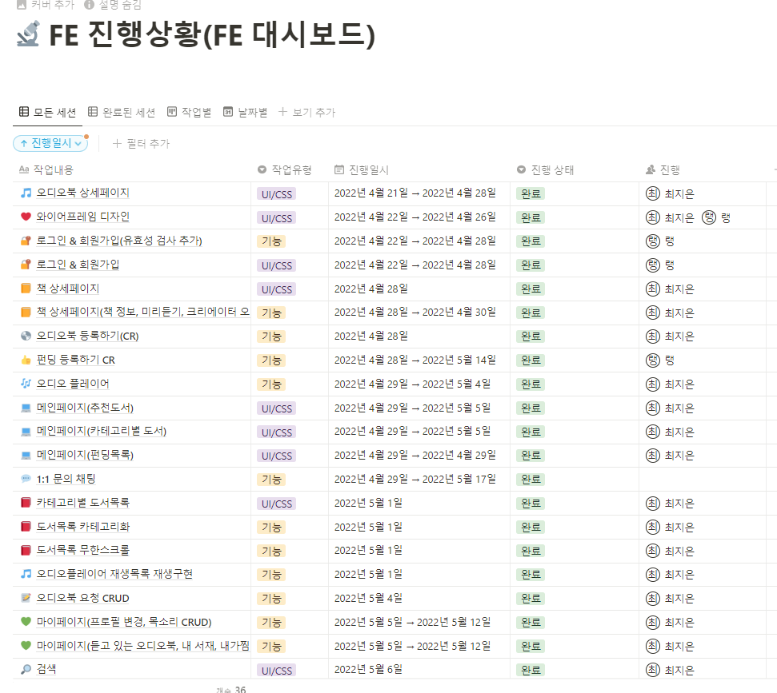

# 실전프로젝트 중간 발표 준비

실전 프로젝트 3주차에 접어들면서 **중간 발표 준비**가 본격적으로 시작되었다. 지금까지 구현해온 기능들을 정리하고, 발표 자료를 준비하며, 팀원들과 함께 프로젝트의 현재 상황을 점검하는 시간을 가졌다.

중간 발표는 단순히 결과물을 보여주는 것이 아니라 **프로젝트의 방향성을 재점검하고 피드백을 받아 개선할 수 있는 중요한 기회**라는 것을 깨달았다. 또한 개발자로서 기술적 내용을 비개발자에게도 이해할 수 있게 설명하는 능력의 중요성을 체감할 수 있었다.

## 진행상황 공유

---

## 소감

10주차를 마무리하며 **프로젝트의 중요한 전환점**을 지났다는 생각이 든다. 중간 발표를 준비하면서 지금까지의 성과를 객관적으로 돌아볼 수 있었고, 앞으로 나아갈 방향을 더 명확하게 설정할 수 있었다.

특히 **팀 협업의 중요성**을 다시 한번 느꼈다. 개인의 역량도 중요하지만, 팀원들과 함께 시너지를 만들어내는 것이 더 큰 가치를 창출한다는 것을 체감했다. 서로 다른 백그라운드를 가진 팀원들이 각자의 강점을 살려 하나의 목표를 향해 나아가는 과정이 정말 값진 경험이었다.

또한 **사용자 중심 사고**의 중요성도 깨달았다. 개발자 관점에서는 당연해 보이는 것들이 실제 사용자에게는 어려울 수 있다는 것을 피드백을 통해 알 수 있었다. 앞으로는 항상 사용자의 입장에서 생각하며 개발하는 습관을 기르고 싶다.

남은 3주 동안 더욱 완성도 높은 서비스를 만들어 최종 발표에서 좋은 결과를 얻고 싶고, 이 경험을 바탕으로 실무에서도 가치 있는 개발자가 되고 싶다.

10주차 공부시간 기록: 128시간 43분

--- 