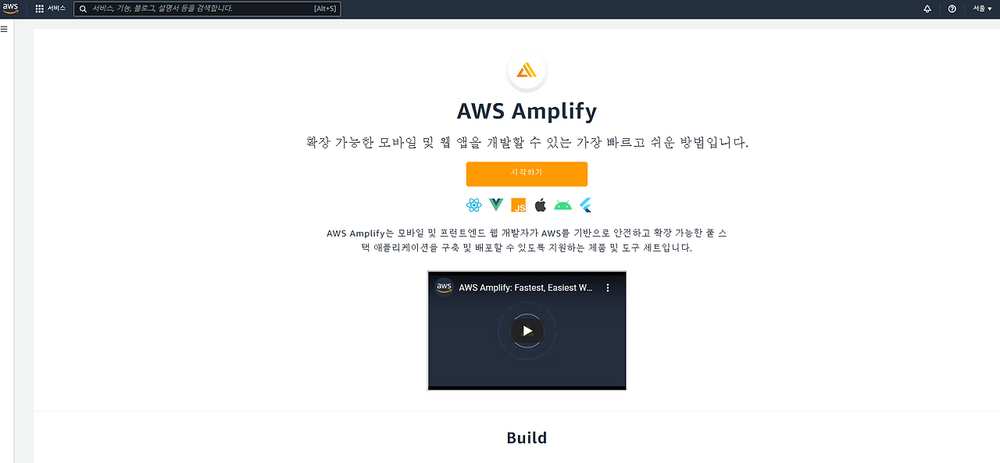
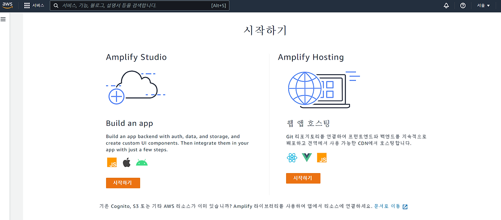
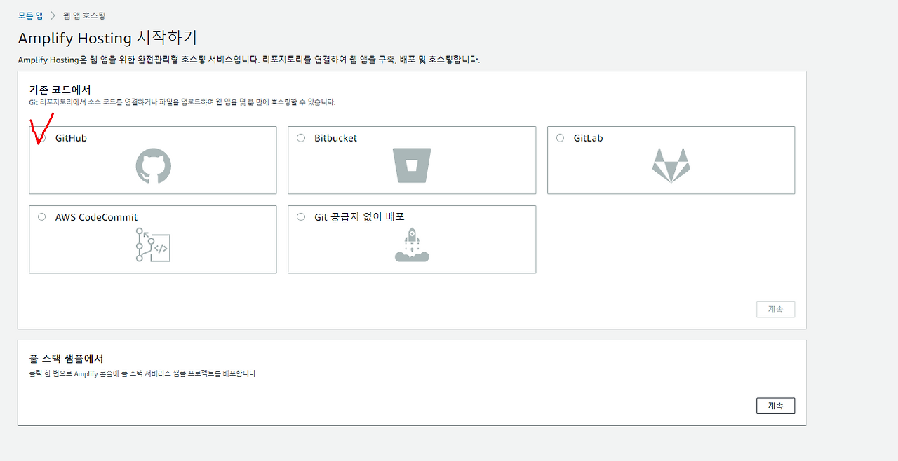
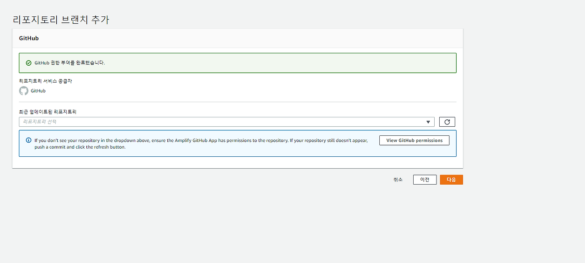
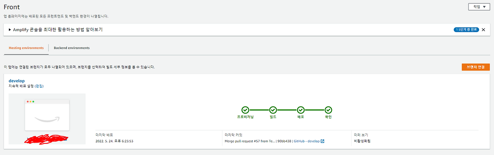

# AWS Amplify 사용기

기본적으로 구현해야하는 **MVP 기능을 구현한 후** AWS Amplify console을 통한 **배포 자동화를 시도**했다. 지금까지는 firebase 웹 호스팅과 AWS S3을 이용해 정적 웹호스팅을 진행했었다면 이번에는 **Git과 연결하여 배포를 자동화시켜주는 AWS Amplify**를 이용했다.

AWS Amplify는 모바일 및 프론트엔드 웹 개발자가 AWS를 기반으로 안전하고 확장 가능한 풀 스택 애플리케이션을 구축 및 배포할 수 있도록 지원하는 제품 및 도구 세트로 프론트엔드뿐만 아니라 백엔드까지 배포자동화 시스템을 구축할 수 있다. **Git 브랜치를 연결해놓으면 자동으로 build가 이루어져 배포가 자동화되는 것이다.**

## AWS Amplify 배포자동화 구축

### AWS Amplify란?

#### 주요 특징
- **Git 브랜치 연결**을 통한 자동 빌드 및 배포
- **SSL 인증서 자동 발급**
- **사용자 지정 도메인** 연결 지원

### (1) AWS Amplify Console 접속




시작하기 버튼을 클릭해 **Amplify Hosting으로 이동** 후 웹 앱 호스팅 시작하기를 클릭한다.

### (2) GitHub 연결



Amplify Hosting을 시작하게 되면 **GitHub를 연결하는 곳으로 이동**하는데 저희 역시 GitHub 브랜치와 연결을 할 것이기 때문에 GitHub를 체크해준 후 레파지토리 브랜치를 추가했다.

### (3) 빌드 스펙 설정
**빌드 스펙같은 경우는 Amplify Console에서 자동으로 프로젝트를 감지하여 작성**되는데 기본구성 그대로 넘어가도 되고 필요한 경우 수정하여 저장해도 된다.

### (4) 검토

검토단계에서는 **이전에 설정한 내용을 다시한번 확인해볼 수 있는 부분**으로 확인해보고 맞으면 저장 및 배포를 클릭한다. **이렇게 몇번의 클릭만으로 배포 자동화를 구축할 수 있다는게 Amplify의 장점**인 것 같다.

### (5) 배포 확인



배포를 하게 되면 아래와 같이 **브랜치별로 배포 정보가 표시**되는데 왼쪽에 나와있는 주소를 넣으면 웹 어플리케이션 링크로 이동하게 된다. 여기서 **사용자 지정 도메인을 추가하고 싶다면 앱 설정의 도메인 관리**를 이용하면 된다.

---

## 사용해보면서 느낀 AWS Amplify의 장점

### (1) 배포 과정이 어렵지 않다

기존의 복잡한 배포 과정과 달리 **몇 번의 클릭만으로 배포 환경을 구축**할 수 있었다. 특별한 서버 설정이나 복잡한 설정 파일 없이도 손쉽게 웹 애플리케이션을 배포할 수 있다는 점이 인상적이었다.

기존에 경험했던 배포 방식들과 비교해보면:
- **수동 배포**: FTP를 통한 파일 업로드의 번거로움
- **Firebase**: 간단하지만 제한적인 기능
- **AWS S3**: 정적 호스팅은 가능하지만 CI/CD 구축의 복잡함

반면 **AWS Amplify는 이러한 모든 단점을 해결**하면서도 간편함을 유지했다.

### (2) Git에서 설정해놓은 branch가 변동될 때마다 자동 build

**CI/CD 파이프라인이 자동으로 구축**되어 코드를 push하면 자동으로 빌드되고 배포되는 과정을 경험할 수 있었다. 이는 개발 효율성을 크게 향상시켜주는 기능이었다.

```
코드 Push → 자동 빌드 → 자동 배포 → 실시간 반영
```

특히 팀 프로젝트에서 여러 명이 동시에 작업할 때 **매번 수동으로 배포할 필요가 없어져** 개발에만 집중할 수 있게 되었다. 또한 **브랜치별로 별도의 배포 환경**을 구축할 수 있어 개발/스테이징/프로덕션 환경을 쉽게 관리할 수 있었다.

### (3) SSL 인증서 발급의 간편함

**HTTPS 설정이 자동으로 이루어져** 보안 설정에 대한 부담이 크게 줄어들었다. 기존에는 복잡했던 SSL 인증서 발급과 적용 과정이 Amplify를 통해 자동으로 처리되었다.

특히나 **Let's Encrypt나 AWS Certificate Manager와의 연동**이 자동으로 이루어져 SSL 인증서 갱신에 대한 걱정도 덜 수 있었다.

### (4) 실시간 모니터링과 로그

배포 상태를 실시간으로 확인할 수 있어 **빌드 실패나 오류 발생 시 즉시 파악**할 수 있었다. 또한 각 배포 단계별 로그를 통해 문제점을 쉽게 찾을 수 있었다.

#### 제공되는 모니터링 기능
- **빌드 로그**: 각 단계별 상세 로그 확인
- **배포 히스토리**: 이전 배포 버전들의 상태 추적
- **에러 알림**: 빌드 실패 시 즉시 알림
- **성능 메트릭**: 웹사이트 성능 지표 확인

---

## 기존 배포 방식과의 비교

### Firebase 웹 호스팅
- **장점**: 설정이 간단하고 빠른 배포, Google 생태계와의 연동
- **단점**: 정적 사이트 호스팅에 제한적, 커스터마이징 한계

### AWS S3 정적 웹 호스팅
- **장점**: 저렴한 비용과 높은 가용성, AWS 서비스와의 연동
- **단점**: 수동 배포 과정, SSL 설정의 복잡함, CI/CD 별도 구축 필요

### AWS Amplify
- **장점**: 자동화된 CI/CD, 쉬운 SSL 설정, Git 연동, 포괄적인 기능
- **단점**: 러닝 커브 존재, 비용 측면에서의 고려 필요

### 경험을 통한 결론

실제로 세 가지 방식을 모두 경험해본 결과, **프로젝트의 성격과 요구사항에 따라 적절한 선택**이 중요하다는 것을 깨달았다:

- **간단한 정적 사이트**: Firebase가 최적
- **비용 중심의 정적 호스팅**: AWS S3
- **CI/CD가 필요한 동적 프로젝트**: AWS Amplify

---

## 프로젝트 EYAGI 현황

### 프로젝트 정보
**프로젝트 기간:** 2022.04.21 ~ 2022.06.02 (총 6주간)
**서비스명:** EYAGI(이야기)
**팀 노션:** [EYAGI 프로젝트](https://balanced-desk-3a4.notion.site/EYAGI-06e6113484324fe8ba37ec83e5e70b8d)

### 현재 진행 상황
- **MVP 기능 구현 완료**: 핵심 기능들이 모두 동작하는 상태
- **배포 자동화 구축**: AWS Amplify를 통한 CI/CD 파이프라인 완성
- **실제 서비스 운영**: 실시간으로 접근 가능한 프로덕션 환경 구축

---

## 팀 협업에서의 배포 자동화 효과

### 개발 효율성 향상

**배포 자동화 이전**:
1. 로컬에서 빌드
2. 빌드 파일 압축
3. 서버에 수동 업로드
4. 웹서버 재시작
5. 동작 확인

**배포 자동화 이후**:
1. Git에 코드 Push
2. 자동 빌드 및 배포
3. 실시간 확인

이로 인해 **배포에 소요되는 시간이 30분에서 5분으로 단축**되었고, 팀원들이 개발에 더 집중할 수 있게 되었다.

### 팀원 간 협업 개선

- **브랜치별 배포 환경**: 각자의 작업을 독립적으로 테스트 가능
- **실시간 피드백**: 변경사항을 즉시 확인하여 빠른 피드백 루프 구성
- **배포 부담 감소**: 배포에 대한 두려움 없이 자유로운 실험과 개선

---

## 소감

11주차를 진행하면서 **실제 프로덕션 환경에서의 배포 과정**을 경험할 수 있었다. 특히 AWS Amplify를 통한 배포 자동화는 개발 워크플로우를 크게 개선시켜주는 경험이었다.

**기술적으로는** CI/CD 파이프라인의 중요성을 깨달았고, 단순히 코드를 작성하는 것을 넘어서 **실제 사용자가 접근할 수 있는 서비스를 만드는 전체 과정**을 이해할 수 있었다. 특히 DevOps의 기초를 경험하면서 개발자로서의 시야가 넓어졌다고 생각한다.

또한 **여러 배포 방식을 비교해보면서** 각각의 장단점을 파악할 수 있었고, 프로젝트 성격에 따라 적절한 배포 방식을 선택하는 것의 중요성을 배웠다. 이는 향후 다른 프로젝트를 진행할 때 큰 자산이 될 것 같다.

**팀 협업 측면에서는** 배포 자동화가 가져다주는 효율성의 증대를 직접 체감할 수 있었다. 더 이상 배포에 대한 부담 없이 자유롭게 실험하고 개선할 수 있게 되었다.

최종 발표를 앞두고 있는 상황에서 **배포 자동화까지 완성**할 수 있어 팀원들과 함께 뿌듯함을 느꼈다. 이제 진짜 '서비스'를 만들었다는 실감이 났고, 사용자들이 실제로 접근할 수 있는 결과물을 만들어낸 성취감이 크다.

남은 기간 동안 더욱 완성도 높은 서비스를 만들어 최종 발표에서 좋은 결과를 얻고 싶고, 이 경험을 바탕으로 실무에서도 빠르게 적응할 수 있는 개발자가 되고 싶다.

<font color='red'>11주차 공부시간 기록: 132시간 38분</font>

--- 